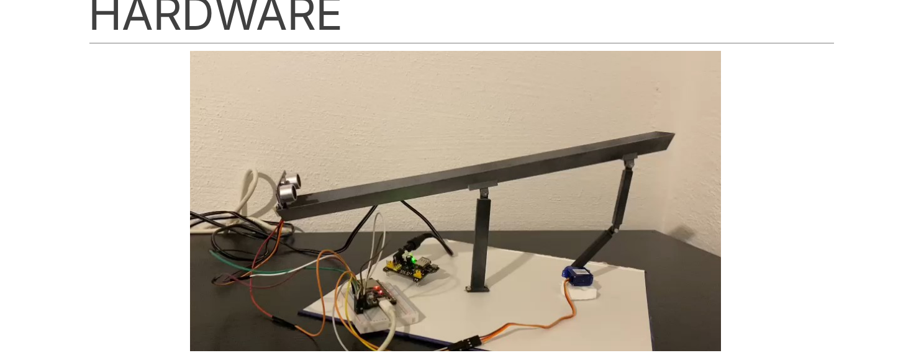
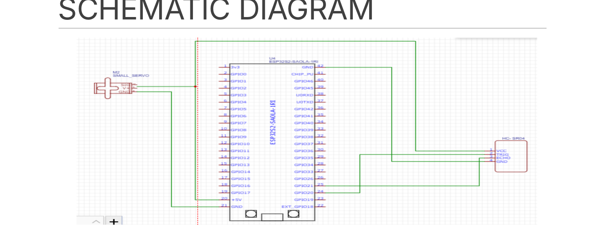
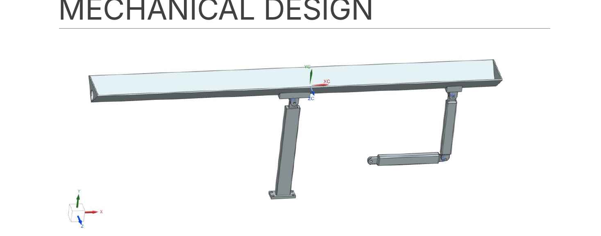

# Ball and Beam – PID Control with ESP32

Case study project (Embedded Systems, TH Deggendorf, winter semester 2022/23): a beam tilted by a servo keeps a ball at a set distance, using an HC-SR04 ultrasonic sensor for feedback and a PID controller running on an ESP32.

## How it works

1. The **HC-SR04** measures the ball's distance from the end of the beam.
2. The **ESP32** compares that to the setpoint (20 cm) and computes a PID output.
3. The output is mapped to a servo angle (clamped to 0–40°) and the **servo** tilts the beam to roll the ball back.

| Parameter | Value |
|---|---|
| Setpoint | 20 cm |
| Kp / Ki / Kd | 8 / 0.2 / 3500 |
| Trigger / Echo pins | GPIO 4 / GPIO 13 |
| Servo pin | GPIO 8 |
| Board (Arduino IDE) | ESP32-S2 Dev Module |

## Repository layout

| Path | Contents |
|---|---|
| `firmware/ball_beam_pid/ball_beam_pid.ino` | Arduino sketch for the ESP32 |
| `cad/nx/` | Siemens NX part files (`.prt`) and printable `.stl` for the beam and the two joints, plus the assembly |
| `docs/images/` | Schematic, mechanical design and hardware photos |

## Firmware

Requires the [ESP32 Arduino core](https://github.com/espressif/arduino-esp32) and the **ESP32Servo** library (Library Manager).
Open `firmware/ball_beam_pid/ball_beam_pid.ino` in Arduino IDE 2.x, select your ESP32 board and upload. Distance readings are printed on the serial monitor at 9600 baud.

The sketch is based on the PID example from [srituhobby.com](https://srituhobby.com), adapted for the ESP32.

## Design

**Schematic** (ESP32, servo and HC-SR04)

**Mechanical design** (Siemens NX). The beam is supported in the centre and tilted through a servo linkage; parts are 3D printed.

## Hardware

| Component | Part |
|---|---|
| Microcontroller | ESP32 |
| Distance sensor | HC-SR04 ultrasonic sensor ([datasheet](https://cdn.sparkfun.com/datasheets/Sensors/Proximity/HCSR04.pdf)) |
| Actuator | Micro servo, DFRobot SER0043 ([datasheet](https://media.digikey.com/pdf/Data%20Sheets/DFRobot%20PDFs/SER0043_Web.pdf)) |
| Structure | 3D-printed beam and joints (`cad/nx/*.stl`) |
| Base | Plywood: 2 × 40 × 2.5 cm, 1 × 60 × 10 cm |
| Fasteners | 1 × M8 × 100 mm threaded pin, 6 × M3 × 20 mm and 6 × M3 × 10 mm screws with nuts |
| Wiring | Breadboard and jumper wires |

## Known limitations

- Friction on the beam affects how well the ball settles.
- The system is one-dimensional (a ball-on-plate would need X and Y control).
- A bouncing ball can't be balanced.
- Tuning the PID gains to hold the ball exactly at the setpoint was the main open challenge.

## References

- Ball and beam control papers consulted: [10.1109/ACC.2011.5990954](https://doi.org/10.1109/ACC.2011.5990954), [10.1109/ICASE.2017.8374271](https://doi.org/10.1109/ICASE.2017.8374271), [10.1109/ICPEICES.2016.7853133](https://doi.org/10.1109/ICPEICES.2016.7853133)
- Course material: *Balancing a ball on a beam* project brief, Prof. Dr. Josef Schmid

## Team (Project 5, Group B)

Arun Thavaramkunnath Ashokan · Ashikh Kadavath · Dennis Joseph George · Jomon Pulucheril Monachan · Rahul Planthottathukunnel Girijan

Supervisor: Prof. Dr. Josef Schmid
